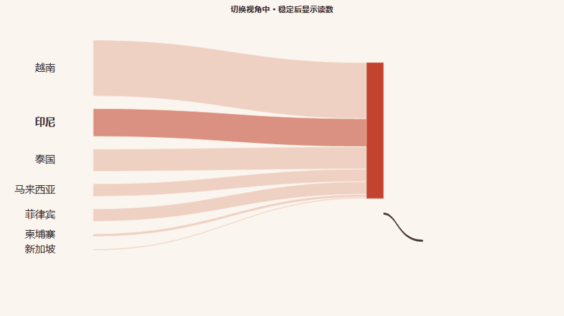
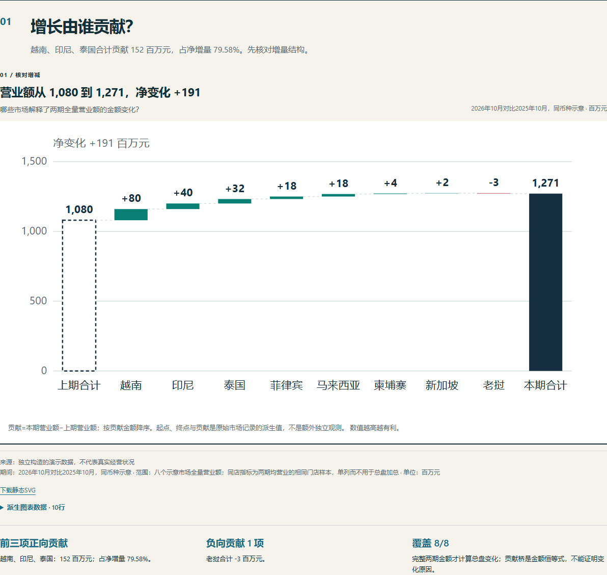

# Data Charts Master

**Charts that answer a question. Design that makes people look.** A chart-design skill for Codex, Claude Code and agents that read `SKILL.md`.

[Live gallery ↗](https://jigongxian900-dotcom.github.io/data-charts-master/) · [Motion demos ↗](https://jigongxian900-dotcom.github.io/data-charts-master/#motion) · [中文](README.md) · [MIT](LICENSE)

[](https://jigongxian900-dotcom.github.io/data-charts-master/)

**54** curated chart/combination examples · **7** original semantic palettes · **3** complete interactive narrative labs. Each case includes its question, units, period, scope, source values and limitations.

## Preview

### Quick judgment / KPIs, trends and comparisons

<picture>
  <source media="(max-width: 600px)" srcset="docs/assets/kpi-mobile.png">
  
</picture>

[Try KPIs](https://jigongxian900-dotcom.github.io/data-charts-master/#kpi-compare) · [Target bullets](https://jigongxian900-dotcom.github.io/data-charts-master/#multi-bullet) · [Attainment states](https://jigongxian900-dotcom.github.io/data-charts-master/#attainment-ring)

### Precise comparison / Shared baselines and direct annotation


[Ranked bars](https://jigongxian900-dotcom.github.io/data-charts-master/#rankedbar) · [Dumbbell](https://jigongxian900-dotcom.github.io/data-charts-master/#dumbbell) · [Butterfly](https://jigongxian900-dotcom.github.io/data-charts-master/#butterfly) · [Waterfall](https://jigongxian900-dotcom.github.io/data-charts-master/#waterfall)

### Deeper analysis / Relationships, distribution and time


[Cohort retention](https://jigongxian900-dotcom.github.io/data-charts-master/#cohort-triangle) · [Connected scatter](https://jigongxian900-dotcom.github.io/data-charts-master/#connected-scatter) · [Parallel coordinates](https://jigongxian900-dotcom.github.io/data-charts-master/#parallel-coordinates) · [All 54 cases](docs/catalog.md)

## Motion explains a change

These GIFs record actual interaction with the included HTML examples. Open a demo to use its controls.

**Scale → contribution → same-store change.** Persistent objects retain identity while the analytical perspective changes.

[](https://jigongxian900-dotcom.github.io/data-charts-master/labs/dir-3.html)

[Open narrative demo ↗](https://jigongxian900-dotcom.github.io/data-charts-master/labs/dir-3.html)

**Growth contribution → target gap.** A flow view changes to a shared-zero comparison. Focus stays linked to the table.

[](https://jigongxian900-dotcom.github.io/data-charts-master/labs/dir-1.html)

[Open flow demo ↗](https://jigongxian900-dotcom.github.io/data-charts-master/labs/dir-1.html) · [Bubble exploration ↗](https://jigongxian900-dotcom.github.io/data-charts-master/labs/dir-2.html)

## Seven palettes, consistent semantics


`ruby` · `tidal` · `cobalt` · `grove` · `iris` · `nocturne` · `graphite`. Focus, categories, sequence, divergence and performance states have separate roles.

## Mobile reading

Narrow layouts recompose KPI cards, mini-trends and complete readings. Complex charts retain a separate original-detail view. Core information does not require hover.

<picture>
  <source media="(max-width: 600px)" srcset="docs/assets/mobile-demo.gif">
  
</picture>

## Install and use

**Only browsing?** Open the [gallery](https://jigongxian900-dotcom.github.io/data-charts-master/), or download the [latest release](https://github.com/jigongxian900-dotcom/data-charts-master/releases/latest) and open `docs/index.html`. Viewing needs no Node.js, Python or API key.

**For an agent:** run one command from your project root. Install Git first.

Codex:

```sh
git clone https://github.com/jigongxian900-dotcom/data-charts-master.git .agents/skills/data-charts-master
```

Claude Code:

```sh
git clone https://github.com/jigongxian900-dotcom/data-charts-master.git .claude/skills/data-charts-master
```

Open an agent session in that project. Invoke `$data-charts-master` in Codex or `/data-charts-master` in Claude Code. If discovery is unavailable, ask the agent to read the installed `SKILL.md` directly.

```text
Use data-charts-master. Identify which regions missed target.
Check periods, units, denominators and missing values before choosing the chart.
Build an offline HTML with source notes, raw table, mobile layout and SVG export.
Use the ruby palette. A missing target is unknown, not zero.
```

### Run a complete example

From the skill folder, with Python 3.10+ (standard library only):

```sh
python scripts/chart_html.py validate examples/representative.json
python scripts/chart_html.py build examples/representative.json --out sample.html --theme ruby
```

On Windows, use `py` if that is your Python launcher. Open `sample.html`. The command also writes `sample.data.json` beside it.

To rebuild all 54 curated examples and the hosted gallery, run `node scripts/build_gallery.js` with Node.js 20+. See [usage, updates and troubleshooting](docs/usage.md).

## One source, report and presentation

[Read one coherent operating case](https://jigongxian900-dotcom.github.io/data-charts-master/operating-story.html): one original eight-market synthetic source connects growth contribution, target shortfall and same-store checks. Titles and monetary summaries are derived from input; an arithmetic bridge does not establish causes.

[](https://jigongxian900-dotcom.github.io/data-charts-master/operating-story.html)

[Open the report](https://jigongxian900-dotcom.github.io/data-charts-master/report.html) · [Open the presentation](https://jigongxian900-dotcom.github.io/data-charts-master/slides.html)

The report uses full-width trends, side notes and direct comparisons. The presentation varies layout by question and offers a focused projection mode on wide screens. Phones use dedicated compact geometry. Both preserve source data and static SVGs in one reference section. The six-kind teaching specimen contains different business domains; use the operating case above for a connected story.

```sh
python scripts/compose_html.py examples/composed/source.json --mode report --theme ruby --out report.html
python scripts/compose_html.py examples/composed/source.json --mode slides --theme ruby --out slides.html
```

These modes use the same six-kind input contract. Narrative comes from the supplied input. Review titles and business explanations after changing values. The HTML presentation is not a native editable PowerPoint file. See [the composition guide](references/composed-outputs.md).

## Scope and license

The 54 examples use fixed synthetic datasets. They do not form an arbitrary-JSON renderer for 54 chart types. A separate Python helper supports six generic types: bar, line, stacked, waterfall, box and scatter. Adaptation requires recalculating titles, scales, labels and derived values.

PPTX guidance requires a separate authoring tool and actual editing checks. The repository does not include a fully native-editable 54-slide deck. The gallery is Chinese-first. This English README does not imply a fully translated chart gallery.

All values are synthetic. They do not describe any company's operations. Original code, documents, palettes and data use **MIT**, including commercial use and modification.

[Validation](docs/validation.md) · [Capability boundaries](references/capability-evidence.md) · [Contributing](CONTRIBUTING.md)

Inspired by [Lieflat Charts](https://github.com/larashero3-dotcom/lieflat-charts), [Diagram Design](https://github.com/cathrynlavery/diagram-design), [Vivid Figures](https://github.com/yjz211/vivid-illustration-skill) and [Tableau](https://www.tableau.com/data-insights/dashboard-showcase). The repository does not include upstream source or artwork. See [notices](THIRD_PARTY_NOTICES.md).
