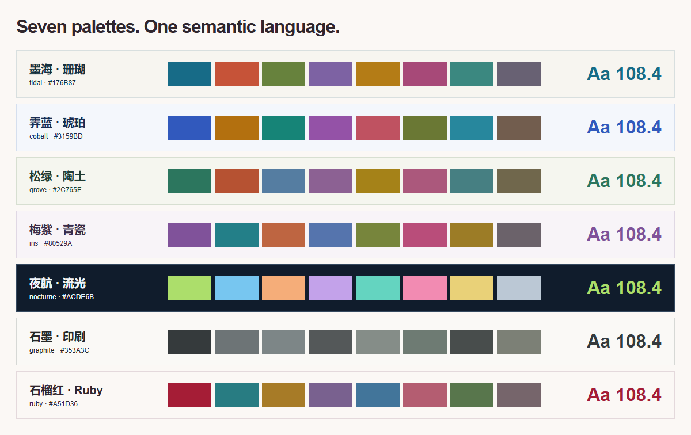

# Jee Charts Master


## 5.4 motion preview

## Diagram motion and HTML report layouts

- [80 animated diagram examples](https://jigongxian900-dotcom.github.io/data-charts-master/diagram-atlas.html) cover workflows, systems, timing, relationships, explanatory forms, and quantitative charts. Search examples and inspect their source fixtures.
- [Workflow and observed paths](https://jigongxian900-dotcom.github.io/data-charts-master/workflow-diagrams.html) combines decision, swimlane, and observed-path views with three styles and SVG export.
- [A4 brief](https://jigongxian900-dotcom.github.io/data-charts-master/report-layouts/brief.html) · [Chapter report](https://jigongxian900-dotcom.github.io/data-charts-master/report-layouts/report.html) · [16:9 presentation](https://jigongxian900-dotcom.github.io/data-charts-master/report-layouts/slides.html) present the same source case at standard sizes.
- [Twelve chart motions](https://jigongxian900-dotcom.github.io/data-charts-master/motion-gallery.html) · [Motion combinations](https://jigongxian900-dotcom.github.io/data-charts-master/motion-composition.html)

[Diagram selection and source crosswalk](references/diagram-atlas.md) · [Report layout guide](references/report-layouts.md)


[Open the interactive motion showcase](https://jigongxian900-dotcom.github.io/data-charts-master/motion-showcase.html) · [Source and offline rebuild](examples/motion-showcase/README.md)

This release adds a bounded numeric SVG scene builder, stable-identity row transitions, metric cards and an artifact preflight. It does not automatically aggregate business data or certify arbitrary designs. All showcase data is synthetic. Existing examples and license boundaries are preserved.

**Turn business questions into custom, interactive HTML and SVG charts.** A chart-design skill for Codex, Claude Code and agents that read `SKILL.md`. Choose the visual structure from the comparison, then design composition, linked exploration and meaningful data motion.

[Live gallery ↗](https://jigongxian900-dotcom.github.io/data-charts-master/) · [Motion demos ↗](https://jigongxian900-dotcom.github.io/data-charts-master/#motion) · [中文](README.md) · [Usage and commercial permission](COMMERCIAL.md)

[](https://jigongxian900-dotcom.github.io/data-charts-master/desktop/tenant-unit-allocation.html)

**54** curated chart/combination examples · **7** original semantic palettes · **3** complete interactive narrative labs. Each case includes its question, units, period, scope, source values and limitations.

## Custom charts for unfamiliar business questions

Three cases start from original questions and synthetic data. The agent chooses the visual form, implements the analysis, then completes an independent internal review and fixes before its first delivery. These are worked cases, not one universal JSON template.

- [Receivables reconciliation](https://jigongxian900-dotcom.github.io/data-charts-master/desktop/receivables-reconciliation.html): signed many-to-many relationships, two-sided tracing and measurement bases. [Source and builder](examples/autonomous-desktop/receivables-reconciliation/README.md).
- [Tenant–unit allocation](https://jigongxian900-dotcom.github.io/data-charts-master/desktop/tenant-unit-allocation.html): constrained global matching, preference, fairness and economic tradeoffs. [Source and builder](examples/autonomous-desktop/tenant-unit-allocation/README.md).
- [Civic request overlap](https://jigongxian900-dotcom.github.io/data-charts-master/desktop/civic-request-overlap.html): exact set partitions and linked workload exploration. [Source and builder](examples/autonomous-desktop/civic-request-overlap/README.md).

[Autonomous production and review](references/autonomous-quality-loop.md) · [Installation and first task](docs/usage.md)

Six additional [regression records](examples/regression/README.md) cover delivery scheduling, outreach experiments, perishable inventory, recruitment, service reliability and booking capacity. Some include same-task repairs. They are recorded separately from unfamiliar first submissions. See [scoped validation](docs/validation.md).

## Preview

### Quick judgment / KPIs, trends and comparisons

<picture>
  <source media="(max-width: 600px)" srcset="docs/assets/kpi-mobile.png">
  
</picture>

[Try KPIs](https://jigongxian900-dotcom.github.io/data-charts-master/#kpi-compare) · [Target bullets](https://jigongxian900-dotcom.github.io/data-charts-master/#multi-bullet) · [Attainment states](https://jigongxian900-dotcom.github.io/data-charts-master/#attainment-ring)

### Precise comparison / Shared baselines and direct annotation


[Ranked bars](https://jigongxian900-dotcom.github.io/data-charts-master/#rankedbar) · [Dumbbell](https://jigongxian900-dotcom.github.io/data-charts-master/#dumbbell) · [Butterfly](https://jigongxian900-dotcom.github.io/data-charts-master/#butterfly) · [Waterfall](https://jigongxian900-dotcom.github.io/data-charts-master/#waterfall)

### Deeper analysis / Relationships, distribution and time


[Cohort retention](https://jigongxian900-dotcom.github.io/data-charts-master/#cohort-triangle) · [Connected scatter](https://jigongxian900-dotcom.github.io/data-charts-master/#connected-scatter) · [Parallel coordinates](https://jigongxian900-dotcom.github.io/data-charts-master/#parallel-coordinates) · [All 54 cases](docs/catalog.md)

## Motion explains a change

These GIFs record actual interaction with the included HTML examples. Open a demo to use its controls.

**Scale → contribution → same-store change.** Persistent objects retain identity while the analytical perspective changes.

[](https://jigongxian900-dotcom.github.io/data-charts-master/labs/dir-3.html)

[Open narrative demo ↗](https://jigongxian900-dotcom.github.io/data-charts-master/labs/dir-3.html)

**Growth contribution → target gap.** A flow view changes to a shared-zero comparison. Focus stays linked to the table.

[](https://jigongxian900-dotcom.github.io/data-charts-master/labs/dir-1.html)

[Open flow demo ↗](https://jigongxian900-dotcom.github.io/data-charts-master/labs/dir-1.html) · [Bubble exploration ↗](https://jigongxian900-dotcom.github.io/data-charts-master/labs/dir-2.html)

## Seven palettes, consistent semantics



`ruby` · `tidal` · `cobalt` · `grove` · `iris` · `nocturne` · `graphite`. Focus, categories, sequence, divergence and performance states have separate roles.

## Mobile reading

The 54-case gallery recomposes KPI cards, mini-trends and complete readings for narrow layouts. The complex worked examples prioritize desktop and retain basic narrow-screen access. Core information does not require hover.

<picture>
  <source media="(max-width: 600px)" srcset="docs/assets/mobile-demo.gif">
  
</picture>

## Install and use

**Only browsing?** Open the [gallery](https://jigongxian900-dotcom.github.io/data-charts-master/), or download the [latest release](https://github.com/jigongxian900-dotcom/data-charts-master/releases/latest) and open `docs/index.html`. Viewing needs no Node.js, Python or API key.

**For an agent:** run one command from your project root. Install Git first.

Codex:

```sh
git clone https://github.com/jigongxian900-dotcom/data-charts-master.git .agents/skills/jee-charts-master
```

Claude Code:

```sh
git clone https://github.com/jigongxian900-dotcom/data-charts-master.git .claude/skills/jee-charts-master
```

Open an agent session in that project. Invoke `$jee-charts-master` in Codex or `/jee-charts-master` in Claude Code. If discovery is unavailable, ask the agent to read the installed `SKILL.md` directly.

```text
Use jee-charts-master. Identify which regions missed target.
Check periods, units, denominators and missing values before choosing the chart.
Build an offline HTML with source notes, raw table, mobile layout and SVG export.
Use the ruby palette. A missing target is unknown, not zero.
```

### Run a complete example

From the skill folder, with Python 3.10+ (standard library only):

```sh
python scripts/chart_html.py validate examples/representative.json
python scripts/chart_html.py build examples/representative.json --out sample.html --theme ruby
```

On Windows, use `py` if that is your Python launcher. Open `sample.html`. The command also writes `sample.data.json` beside it.

To rebuild all 54 curated examples and the hosted gallery, run `node scripts/build_gallery.js` with Node.js 20+. See [usage, updates and troubleshooting](docs/usage.md).

## One source, report and presentation

[Read one coherent operating case](https://jigongxian900-dotcom.github.io/data-charts-master/operating-story.html): one original eight-market synthetic source connects growth contribution, target shortfall and same-store checks. Titles and monetary summaries are derived from input; an arithmetic bridge does not establish causes.

[](https://jigongxian900-dotcom.github.io/data-charts-master/operating-story.html)

[Open the report](https://jigongxian900-dotcom.github.io/data-charts-master/report.html) · [Open the presentation](https://jigongxian900-dotcom.github.io/data-charts-master/slides.html)

The report uses full-width trends, side notes and direct comparisons. The presentation varies layout by question and offers a focused projection mode on wide screens. Phones use dedicated compact geometry. Both preserve source data and static SVGs in one reference section. The six-kind teaching specimen contains different business domains; use the operating case above for a connected story.

```sh
python scripts/compose_html.py examples/composed/source.json --mode report --theme ruby --out report.html
python scripts/compose_html.py examples/composed/source.json --mode slides --theme ruby --out slides.html
```

These modes accept the six built-in contracts, with an optional author-side registry for new encodings. Narrative comes from the supplied input. Review titles and business explanations after changing values. The HTML presentation is not a native editable PowerPoint file. See [the composition guide](references/composed-outputs.md).

## Design beyond the atlas

The 54 examples are craft references. Start with relationships that must be seen together, then choose marks, shared scales, layers, facets and coordinate or hierarchy transformations. An absent chart name is not a capability limit. Reject an elaborate design when its data conditions do not hold.

The optional author-side renderer accepts original SVG compositions while retaining source-row coverage, exact data, mobile variants and complete static exports. Geometry utilities supply scales, area-correct sectors and hierarchy partitions; they do not choose the business analysis.

[Composition reasoning](references/composition-reasoning.md) · [Nine-work mechanism library](references/inspiration-library.json) · [Using inspiration](references/inspiration-use.md) · [Custom renderers](references/custom-renderers.md)

Eight original static previews were inspected; one work has curator-only evidence. Original interactions were not exercised. The library distributes links and original mechanism analysis, not third-party artwork or templates.

### Three unfamiliar worked tasks

Independent fresh contexts produced two meaningful compound or transformed encodings and one valid refusal of unsupported flow. Initial review found expanded-layout and print defects. Those failures were retained, then repaired and retested on the same tasks; repairs did not increase the unfamiliar-task count.

[Cycle and hierarchy](https://jigongxian900-dotcom.github.io/data-charts-master/autonomy/energy-cycle.html) · [Quality and observation coverage](https://jigongxian900-dotcom.github.io/data-charts-master/autonomy/quality-support.html) · [Refusing invalid flow](https://jigongxian900-dotcom.github.io/data-charts-master/autonomy/renewal-evidence.html)

Sources and portable producers live in `examples/autonomy/`. Their rebuilt HTML and calculations match the reviewed artifacts byte for byte. These are fixed synthetic worked examples, not new arbitrary-input templates. Independent AI review is not external certification.

## Try the work, then install

[Explore the gallery](https://jigongxian900-dotcom.github.io/data-charts-master/) · [Track objects through a real view change](https://jigongxian900-dotcom.github.io/data-charts-master/labs/dir-3.html) · [Commercial permission](COMMERCIAL.md)

The new optional motion mechanism preserves IDs, reverses from the visible frame, responds to runtime reduced-motion preferences and provides stable exports. Authors still define meaningful interaction, scales, units and path compatibility. Online examples need no installation; production through the Skill needs an existing compatible agent environment.

From v5.3, new original additions and changes use PolyForm Noncommercial, with separate commercial permission. Historical MIT grants remain valid. Self-service payment is not enabled and no sales volume is claimed.

## Scope and license

The 54 examples use fixed synthetic datasets. They do not form an arbitrary-JSON renderer for 54 chart types. A separate Python helper supports six generic types: bar, line, stacked, waterfall, box and scatter. Adaptation requires recalculating titles, scales, labels and derived values.

PPTX guidance requires a separate authoring tool and actual editing checks. The repository does not include a fully native-editable 54-slide deck. The gallery is Chinese-first. This English README does not imply a fully translated chart gallery.

Our operating examples are synthetic. New original additions and changes from v5.3 use [PolyForm Noncommercial](LICENSE); commercial use requires separate permission. [License scope](LICENSE-SCOPE.md) preserves historical MIT grants and distinguishes unchanged, modified and new material. This is source-available, not unrestricted free commercial open source. Linked third-party works retain their own rights.

[Validation](docs/validation.md) · [Capability boundaries](references/capability-evidence.md) · [Contributing](CONTRIBUTING.md)

Inspired by [Lieflat Charts](https://github.com/larashero3-dotcom/lieflat-charts), [Diagram Design](https://github.com/cathrynlavery/diagram-design), [Vivid Figures](https://github.com/yjz211/vivid-illustration-skill) and [Tableau](https://www.tableau.com/data-insights/dashboard-showcase). The repository does not include upstream source or artwork. See [notices](THIRD_PARTY_NOTICES.md).

Useful results deserve real feedback. Star the project to find it again, report a reproducible issue or contribute an original synthetic case. No Star is required to download, try or discuss a license.
