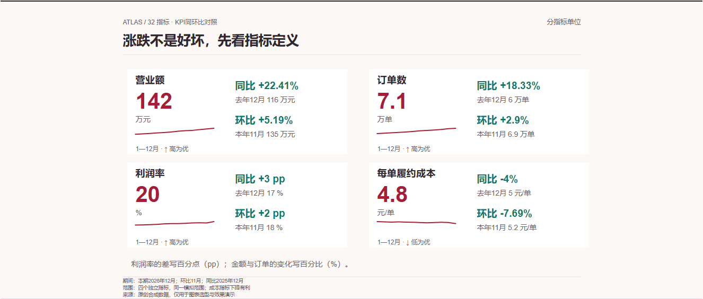
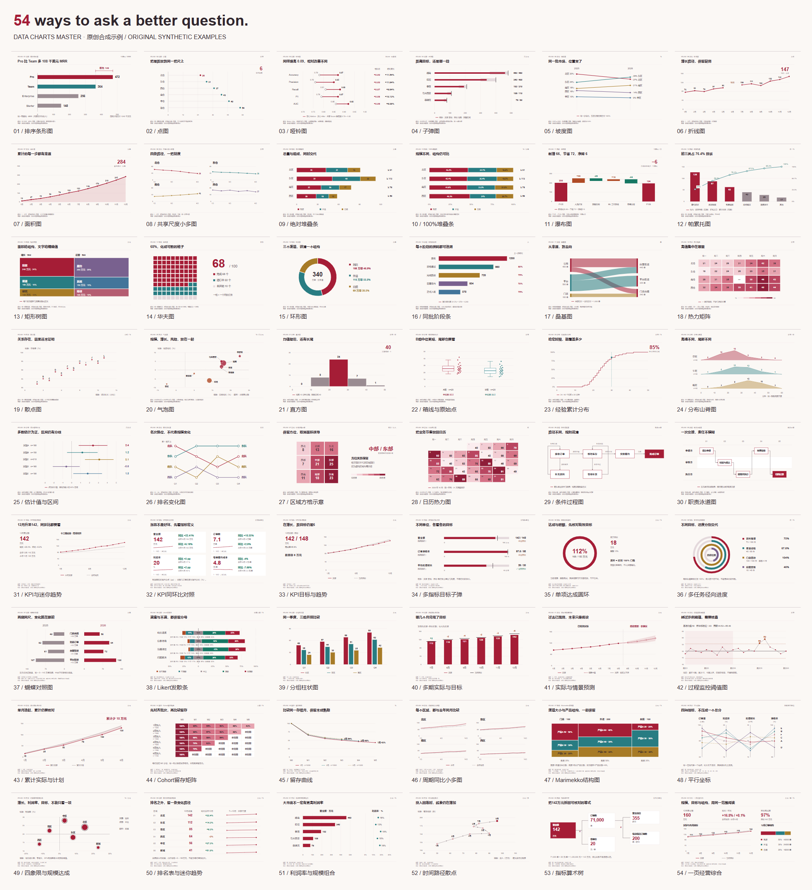
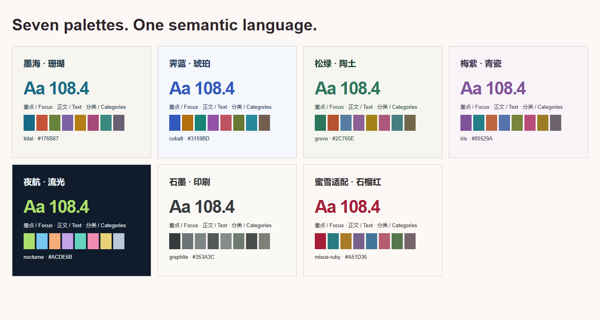
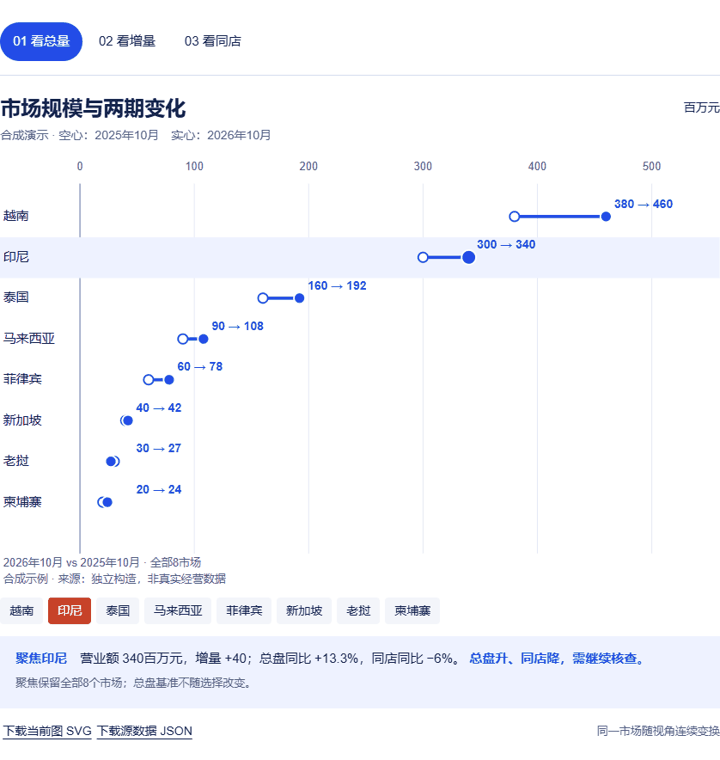

# Data Charts Master

**Choose the chart that answers the question. Then make it worth reading.**

[Live gallery](https://jigongxian900-dotcom.github.io/data-charts-master/) · [54-case catalogue](docs/catalog.md) · [中文](README.md) · [MIT](LICENSE)



A chart-design skill for business analysis and reporting: 54 curated chart/combination examples, seven original semantic palettes, three interactive narrative labs, and a Python helper for six generic chart types.

The gallery includes KPI sparklines, year/month comparisons, target bullets, attainment rings, butterflies, cohorts, retention curves, Marimekko, parallel coordinates, rank/spark tables, arithmetic trees and linked operating overviews. Each example exposes its business question, period, units, scope, raw values and limitations.



## Use

```sh
git clone https://github.com/jigongxian900-dotcom/data-charts-master.git
cd data-charts-master
```

Ask your agent to read `SKILL.md`, or place this folder in your agent's supported custom-skill directory. Provide the business question, data, audience and required output. The skill and gallery are Chinese-first; the English README does not imply a fully translated gallery.

```sh
node examples/dashboard-atlas/build_atlas.js
python scripts/chart_html.py validate examples/representative.json
python scripts/chart_html.py build examples/representative.json --out sample.html --theme mixue-ruby
python scripts/test_chart_html.py
python scripts/verify_release.py
```

Node.js 20+ / Python 3.10+. The generator and Python helper have no third-party dependencies. The HTML works offline without installation.



[Try the narrative lab](https://jigongxian900-dotcom.github.io/data-charts-master/labs/dir-3.html).



## Scope

These are curated examples, not a universal arbitrary-JSON renderer for 54 chart types. The Python helper supports bar, line, stacked, waterfall, box and scatter. Adaptation requires recalculating derived values, titles, scales and annotations. PPTX guidance requires a separate authoring tool and actual editing verification; a native-editable 54-slide deck is not bundled.

All numerical examples use original synthetic data. Process diagrams are conceptual. They do not describe any company's operations. The ruby palette is an original brand-adapted option, not official Mixue visual identity. No official logo or character art is included.

See [validation](docs/validation.md), [usage](docs/usage.md), [capability boundaries](references/capability-evidence.md) and [contributing](CONTRIBUTING.md).

## Inspiration and license

Inspired by [Lieflat Charts](https://github.com/larashero3-dotcom/lieflat-charts), [Diagram Design](https://github.com/cathrynlavery/diagram-design), [Vivid Figures](https://github.com/yjz211/vivid-illustration-skill) and [Tableau showcase](https://www.tableau.com/data-insights/dashboard-showcase). No upstream source, templates or artwork are bundled. See [notices](THIRD_PARTY_NOTICES.md).

Original code, documentation, palettes and synthetic data: **MIT**, including commercial use and modification.
