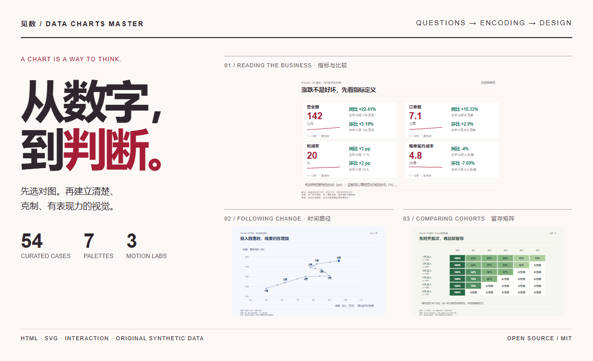
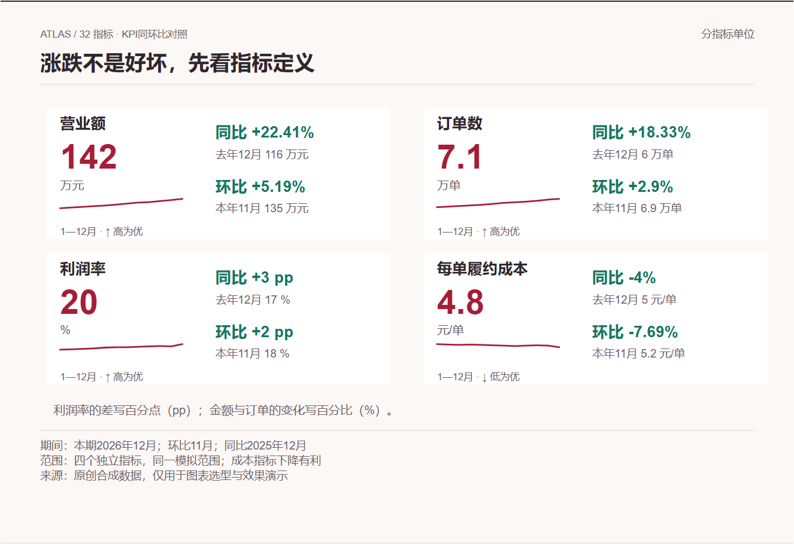
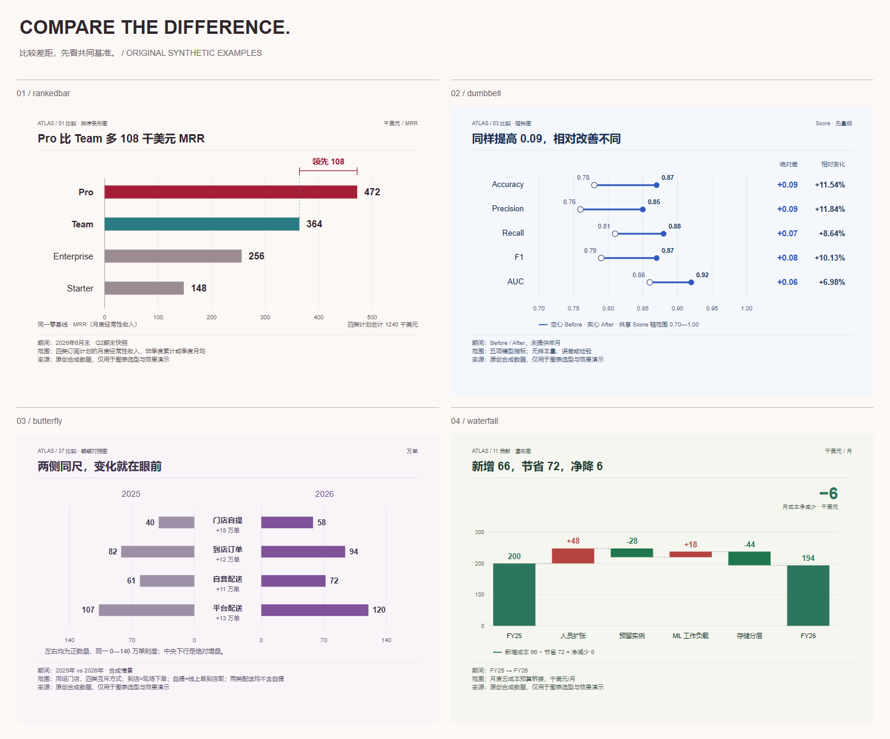
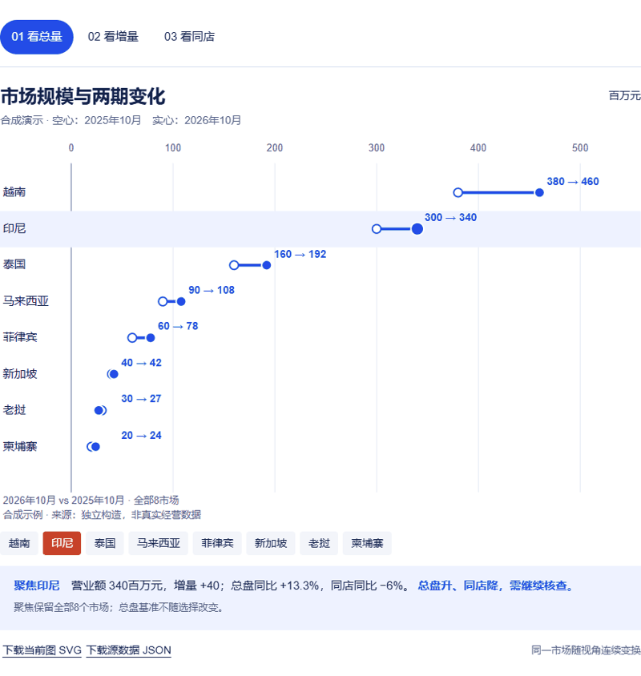
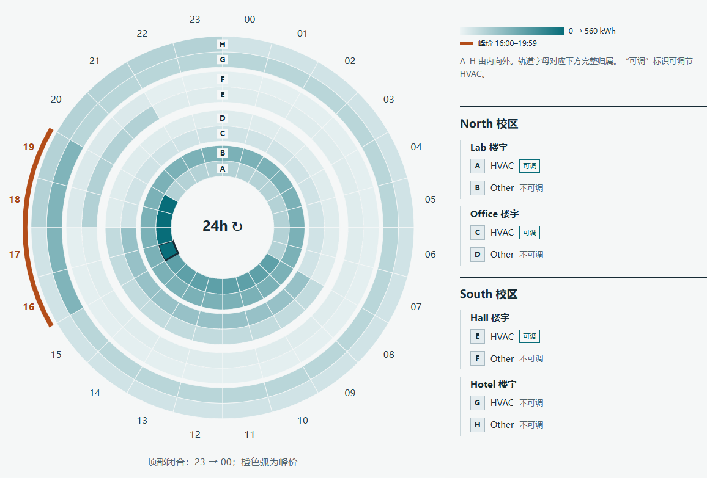
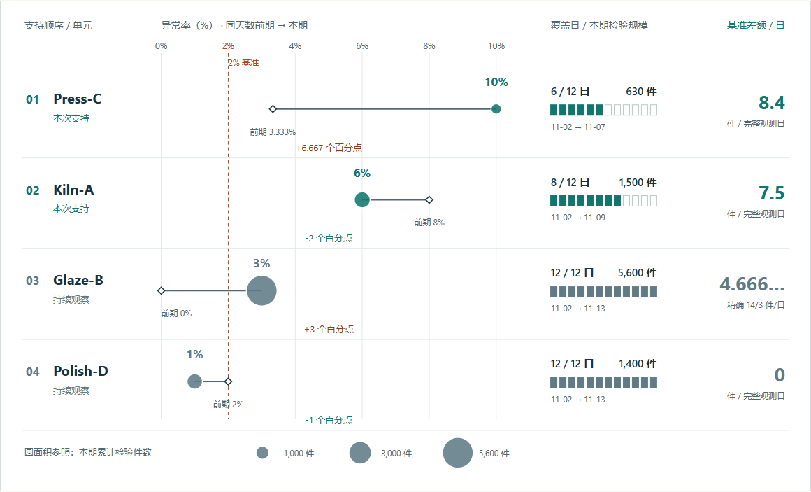

# Data Charts Master · 见数

**让图表回答问题，也让人愿意看。** 面向 Codex、Claude Code 和兼容 `SKILL.md` 的 Agent：业务选图、视觉设计、HTML 交互与 SVG 输出。

[在线图谱 ↗](https://jigongxian900-dotcom.github.io/data-charts-master/) · [交互动效 ↗](https://jigongxian900-dotcom.github.io/data-charts-master/#motion) · [安装使用](#安装与第一次使用) · [English](README.en.md) · [MIT](LICENSE)

[](https://jigongxian900-dotcom.github.io/data-charts-master/)

**54** 个图表与组合实例 · **7** 套原创语义配色 · **3** 个交互叙事实例。示例可离线打开，附原始值、业务问题、适用条件与阅读边界。

## 先看效果

### 01 / 快速判断：数字、趋势、基准一起看

KPI 卡片同时交代当前值、迷你趋势、同比和环比。利润率用百分点，成本下降按“低为优”解释。

<picture>
  <source media="(max-width: 600px)" srcset="docs/assets/kpi-mobile.png">
  
</picture>

[体验 KPI](https://jigongxian900-dotcom.github.io/data-charts-master/#kpi-compare) · [目标子弹图](https://jigongxian900-dotcom.github.io/data-charts-master/#multi-bullet) · [四种达成状态](https://jigongxian900-dotcom.github.io/data-charts-master/#attainment-ring) · [经营组合页](https://jigongxian900-dotcom.github.io/data-charts-master/#operating-overview)

### 02 / 精确比较：把差距放回同一把尺

排序、前后变化、目标差额和蝴蝶对照，各自回答不同问题。重点色承担比较，数量编码保留共同基准。



[排序条形](https://jigongxian900-dotcom.github.io/data-charts-master/#rankedbar) · [哑铃](https://jigongxian900-dotcom.github.io/data-charts-master/#dumbbell) · [蝴蝶](https://jigongxian900-dotcom.github.io/data-charts-master/#butterfly) · [瀑布](https://jigongxian900-dotcom.github.io/data-charts-master/#waterfall)

### 03 / 深入分析：关系、分布与时间放在一起

从留存矩阵到多维关系，先判断比较条件，再用共享尺度、直接标注和必要的解释控制复杂度。


[Cohort 留存](https://jigongxian900-dotcom.github.io/data-charts-master/#cohort-triangle) · [时间路径散点](https://jigongxian900-dotcom.github.io/data-charts-master/#connected-scatter) · [平行坐标](https://jigongxian900-dotcom.github.io/data-charts-master/#parallel-coordinates) · [全部54例](docs/catalog.md)

<details>
<summary>展开54例总览</summary>


</details>

## 动效用于解释变化

下面是实际 HTML 交互的录屏。点击链接即可操作；GIF 是预览，不替代交互。

### 同一组对象，三种判断

规模 → 增量 → 同店。对象身份保持连续，位置和编码随问题变化，避免重新寻找同一市场。

[](https://jigongxian900-dotcom.github.io/data-charts-master/labs/dir-3.html)

[打开叙事实例 ↗](https://jigongxian900-dotcom.github.io/data-charts-master/labs/dir-3.html)

### 从增长贡献，切到目标差额

流带展示增量关系；差额视角改用共零基线，清楚区分超额和缺口。聚焦对象与原始表同步。

[](https://jigongxian900-dotcom.github.io/data-charts-master/labs/dir-1.html)

[打开流带与差额实例 ↗](https://jigongxian900-dotcom.github.io/data-charts-master/labs/dir-1.html) · [气泡位置与市场联动 ↗](https://jigongxian900-dotcom.github.io/data-charts-master/labs/dir-2.html)

## 设计图谱里还没有的图

54例提供工艺参考。新任务先推导必须共同看见的关系，再选择标记、共享尺度、分面、叠加、坐标或层级变换。没有同名样例也可以设计；数据条件不成立时，应改用有效的简单表达。

5.2新增可选的作者侧绘图接口：自写SVG可以接入同一报告，保留逐源行覆盖、精确读数、手机重排与完整静态导出。通用数学部件提供尺度、面积正确的扇区和层级分区；业务判断仍由Agent完成。

[组合与变形推理](references/composition-reasoning.md) · [9件作品的机制灵感库](references/inspiration-library.json) · [如何使用灵感](references/inspiration-use.md) · [接入自定义绘图](references/custom-renderers.md)

灵感来自DKMECO与Tableau具体作品，记录原作、机制、适用条件和反例。8件核看原作静态预览，1件仅有策展证据；原作交互未实测。库中只分发链接和原创分析。

```text
使用 data-charts-master。先判断这道业务问题需要共同看到哪些关系。
图谱没有合适样例时，请自主组合标记与尺度，或变换坐标、层级。
说明组合多揭示了什么、最简单的有效备选，以及不能误读的条件。
输出离线HTML、原始表、派生值、手机布局和包含全部图层的SVG。
```

### 三道新题的制作实录

三个独立上下文只拿技能与各自输入制作。两题推导出真实图内组合或坐标/层级变换，一题拒绝数据不支持的复杂流向。首轮评审发现展开布局及打印缺陷，保留失败后完成同题技术复验；修复没有增加陌生题数量。

[](https://jigongxian900-dotcom.github.io/data-charts-master/autonomy/energy-cycle.html)

[体验周期与层级视图](https://jigongxian900-dotcom.github.io/data-charts-master/autonomy/energy-cycle.html) · [源数据与制作器](examples/autonomy/energy-cycle/README.md)

[](https://jigongxian900-dotcom.github.io/data-charts-master/autonomy/quality-support.html)

[体验质量与工时联合判断](https://jigongxian900-dotcom.github.io/data-charts-master/autonomy/quality-support.html) · [源数据与制作器](examples/autonomy/quality-support/README.md) · [为什么这题拒绝复杂流向](https://jigongxian900-dotcom.github.io/data-charts-master/autonomy/renewal-evidence.html)

这些是固定原创合成数据的推理实录。公开制作器仅适配路径与来源验证，重建HTML及计算与评审实物逐字节一致；换数据仍需重新规划与验证。独立AI评审不等于外部认证或全部图型的能力保证。

## 七套配色，一套语义

石榴红、潮汐青、钴蓝、林地绿、鸢尾紫、夜航与石墨。每套区分焦点、类别、顺序、发散和绩效状态；换主题保持数据与比例。


主题标识：`ruby` · `tidal` · `cobalt` · `grove` · `iris` · `nocturne` · `graphite`。

## 手机也能读

窄屏使用重新排布的 KPI、迷你趋势与完整读数，复杂图可查看原图细节。核心说明不依赖悬停。

<picture>
  <source media="(max-width: 600px)" srcset="docs/assets/mobile-demo.gif">
  
</picture>

[直接在手机打开](https://jigongxian900-dotcom.github.io/data-charts-master/) · [实际检查范围](docs/validation.md)

## 安装与第一次使用

### 只想看图？不用安装

打开[在线图谱](https://jigongxian900-dotcom.github.io/data-charts-master/)。要离线查看，可下载[最新版本](https://github.com/jigongxian900-dotcom/data-charts-master/releases/latest)，解压后打开 `docs/index.html`。浏览图谱不需要 Node.js、Python 或 API Key。

### 让 Agent 使用

在**你的项目根目录**执行下面对应的一条命令（需要 Git）。Windows PowerShell、macOS 和 Linux 均可使用。

**Codex：**

```sh
git clone https://github.com/jigongxian900-dotcom/data-charts-master.git .agents/skills/data-charts-master
```

**Claude Code：**

```sh
git clone https://github.com/jigongxian900-dotcom/data-charts-master.git .claude/skills/data-charts-master
```

然后在该项目中打开 Agent 会话。Codex 输入 `$data-charts-master`，Claude Code 输入 `/data-charts-master`，再描述任务。没有自动发现时，让 Agent 直接读取安装目录中的 `SKILL.md`。

复制这个示例，再附上你的数据：

```text
使用 data-charts-master。我要判断哪些区域没有达到目标。
请先核对期间、单位、分母和缺失值，再选择合适图表。
生成可离线打开的单文件 HTML，带来源、原始表、手机布局和 SVG 下载。
采用石榴红，目标缺失时显示未知，不补零。
```

[详细安装、更新、卸载与排错](docs/usage.md) · [Agent 能力入口](SKILL.md)

### 先跑一个完整样例

克隆或下载后，进入技能文件夹。下面只需要 **Python 3.10+**，不需要安装第三方包：

```sh
python scripts/chart_html.py validate examples/representative.json
python scripts/chart_html.py build examples/representative.json --out sample.html --theme ruby
```

Windows 的 Python 命令若为 `py`，将上面的 `python` 改为 `py`。生成 `sample.html` 和 `sample.data.json`；用浏览器打开前者即可。

**想修改54例图谱？** 用 Node.js 20+ 运行 `node scripts/build_gallery.js`。它会同步生成示例 HTML、54份 SVG 与公开展示页。[生成文件与目录说明](docs/usage.md#开发与重建)

## 同一份数据，报告与演示两种表达

[先读一份完整经营案例 ↗](https://jigongxian900-dotcom.github.io/data-charts-master/operating-story.html)：同一组八市场合成数据，连续回答增长由谁贡献、目标还差多少、哪些市场需要复核同店表现。三张图按问题换布局，标题和金额随输入计算；不把贡献恒等式写成因果。

[](https://jigongxian900-dotcom.github.io/data-charts-master/operating-story.html)

[打开报告示例](https://jigongxian900-dotcom.github.io/data-charts-master/report.html) · [打开可翻页演示](https://jigongxian900-dotcom.github.io/data-charts-master/slides.html)

报告按问题安排通栏趋势、旁注、比较与分布；演示按比较关系编排，宽屏可切换“聚焦投影”，手机使用重新编排的紧凑图形。同源原值与静态SVG保存在统一资料区。六图教学样例含不同业务，不能连成同一因果故事；上面的经营案例提供同源连续叙事。

```sh
python scripts/compose_html.py examples/composed/source.json --mode report --theme ruby --out report.html
python scripts/compose_html.py examples/composed/source.json --mode slides --theme ruby --out slides.html
```

这两种模式可读取六类基础合同，也可通过作者侧注册函数接入新表达；叙事由输入明确提供。改变数据必须重新核对标题与业务解释。HTML演示不冒充原生可编辑PowerPoint。[输入与模式说明](references/composed-outputs.md)

## 范围与许可

54例是按固定合成数据编写的完整实例；Python 基础助手另支持横条、折线、堆叠、瀑布、箱线和散点六类通用图，可选自定义绘图接口用于新的组合与变形。迁移时要重算标题、标注、尺度与派生值。

PPTX 提供制作与验证方法，需要另配制作工具；本仓库没有打包全原生数据可编辑的54页演示文稿。图谱以中文为主，英文 README 不代表图表已全部英文化。

原创代码、文档、配色和合成数据采用 **MIT**，允许商用和修改。本仓库生成的经营图表示例均使用合成数据，不代表任何公司的实际经营；灵感库中的第三方作品及其资料仍适用各自权利与许可。

[验证范围](docs/validation.md) · [能力边界](references/capability-evidence.md) · [贡献方式](CONTRIBUTING.md)

视觉与仓库呈现参考 [Lieflat Charts](https://github.com/larashero3-dotcom/lieflat-charts)、[Diagram Design](https://github.com/cathrynlavery/diagram-design)、[Vivid Figures](https://github.com/yjz211/vivid-illustration-skill) 和 [Tableau](https://www.tableau.com/data-insights/dashboard-showcase)。独立实现，未打包上述项目的源码、模板或图像。[第三方说明](THIRD_PARTY_NOTICES.md)
