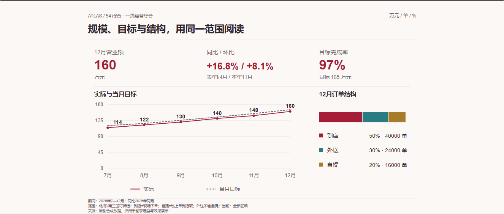
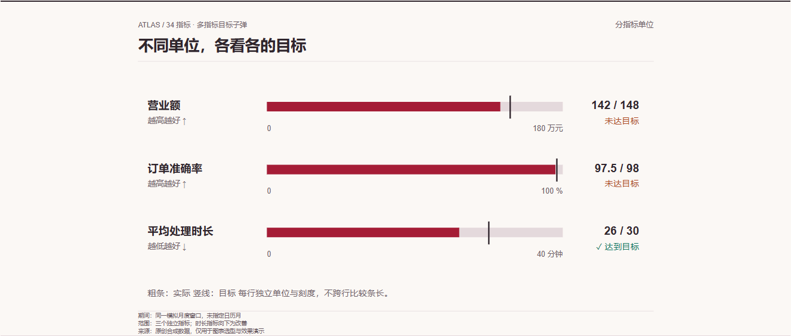
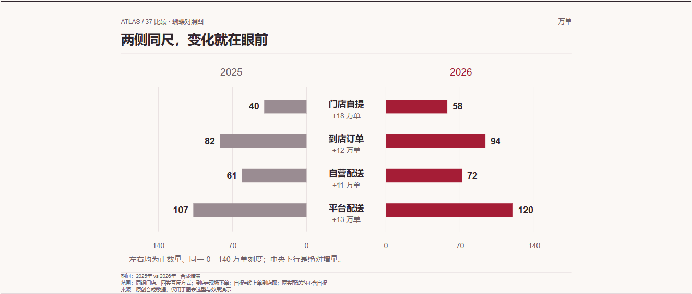
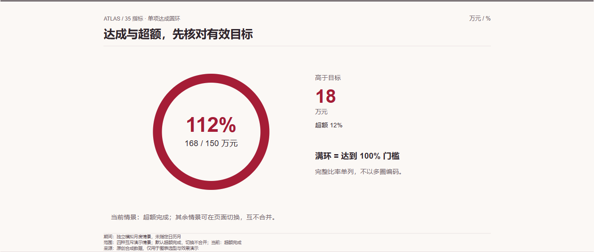
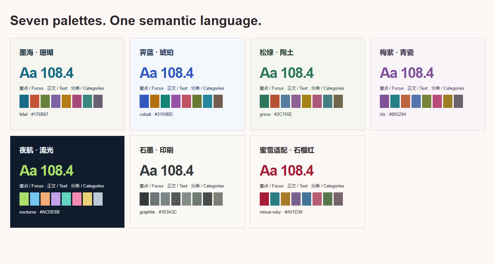

# Data Charts Master · 见数

**先选对图，再把图做好看。** 面向经营分析与数据汇报的图表设计技能，带完整可运行示例。

[在线体验](https://jigongxian900-dotcom.github.io/data-charts-master/) · [54例目录](docs/catalog.md) · [English](README.en.md) · [MIT](LICENSE)


## 先看效果

54个图表与组合实例，七套原创语义配色。HTML离线可用，配原始值查阅、SVG/JSON下载、打印、手机布局与键盘操作。

| KPI与经营概览 | 比较与目标 |
|---|---|
|  |  |
|  |  |


[交互叙事示例](https://jigongxian900-dotcom.github.io/data-charts-master/labs/dir-3.html)：从规模到增量，再看同店；持续对象变化与同源表联动。


## 它能做什么

- **按业务问题选图**：比较、趋势、构成、贡献、分布、关系、空间、流程；解释为什么选，也保留限制。
- **常用与复杂图形**：KPI趋势/同环比、子弹、圆环达成、蝴蝶、Likert、cohort、留存、Marimekko、平行坐标、排名趋势、算术拆解树与经营组合页。
- **七套颜色语言**：浅底、深底、打印与原创石榴红。重点、分类、顺序、发散、正向与不利各有角色。
- **HTML与SVG**：独立页面、真实筛选、稳定态导出、减弱动态与打印；图表、表格、下载同源。
- **PPTX方法**：按视觉保真与实际编辑需求选择输出路线。需要独立制作工具；本仓库不附全原生数据可编辑的54页PPTX。



## 使用

```sh
git clone https://github.com/jigongxian900-dotcom/data-charts-master.git
cd data-charts-master
```

让你的Agent读取 [SKILL.md](SKILL.md)，并提供业务问题、数据、受众和格式。按使用工具支持的自定义技能目录安装这一份文件夹即可。[使用说明与提示词](docs/usage.md)

```sh
# 重建54例HTML、源数据与SVG（Node.js，无第三方依赖）
node examples/dashboard-atlas/build_atlas.js
# 六类通用图形助手（Python标准库）
python scripts/chart_html.py validate examples/representative.json
python scripts/chart_html.py build examples/representative.json --out sample.html --theme mixue-ruby
# 行为测试与公开包检查
python scripts/test_chart_html.py
python scripts/verify_release.py
```

Node.js 20+ / Python 3.10+。直接阅读HTML和SVG不需要安装依赖。

## 边界与验证

54例是精心编写的可运行案例，**不是任意JSON都能套入的通用54图引擎**。Python助手支持六类通用图。换数据时要重算标题、标注、尺度与派生值。

所有数值均为原创合成演示，流程为机制示意；不代表蜜雪或其他公司的经营事实。石榴红为原创适配色，非官方VI。没有加入任何官方Logo或IP。

[本版本验证范围](docs/validation.md) · [能力边界](references/capability-evidence.md)。不以内部评分、星数或模板数量宣称行业领先。

## 参考与许可

感谢 [Lieflat Charts](https://github.com/larashero3-dotcom/lieflat-charts) 的仓库呈现与叙事启发，以及 [Diagram Design](https://github.com/cathrynlavery/diagram-design)、[Vivid Figures](https://github.com/yjz211/vivid-illustration-skill)、[Tableau优秀案例](https://www.tableau.com/data-insights/dashboard-showcase) 的视觉启发。

本仓库为独立原创实现，未打包上述项目的源码、模板或图像。[第三方说明](THIRD_PARTY_NOTICES.md)。本项目原创代码、文档、配色和合成数据采用 **MIT**，允许商业使用与修改。
