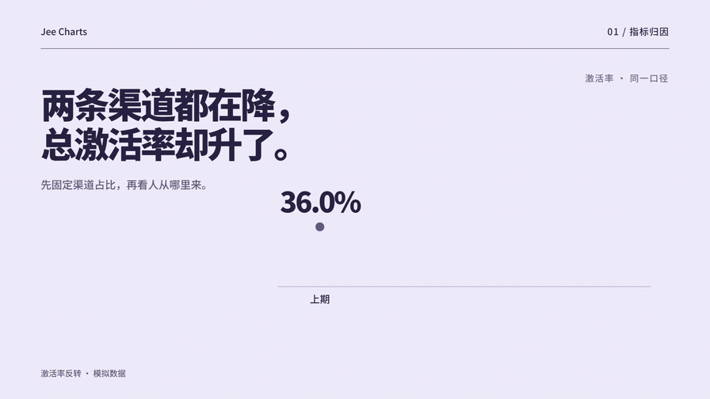
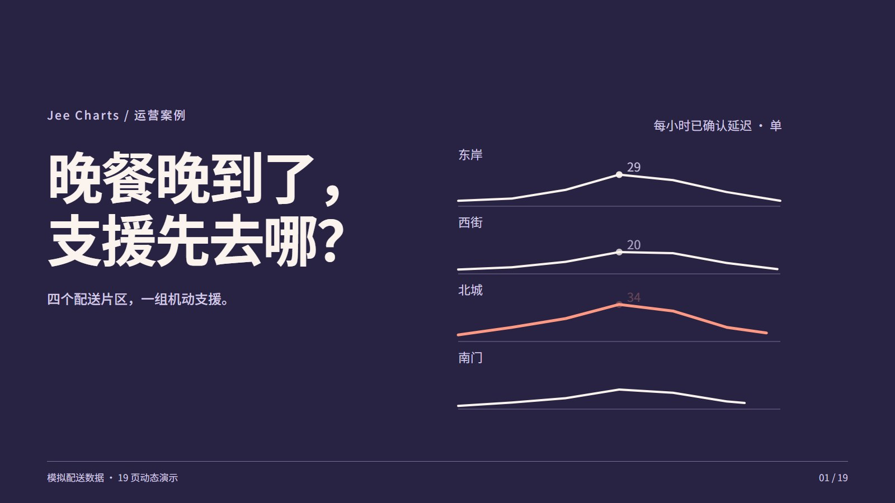

<p align="center"></p>

# Jee Charts · 见数

从业务问题出发，生成能交付的**图表、交互报告和动态演示**。适用于 Codex、Claude Code 和支持 `SKILL.md` 的 Agent。

[打开作品集 ↗](https://jigongxian900-dotcom.github.io/data-charts-master/showcase/) · [看宣传片 ↗](https://jigongxian900-dotcom.github.io/data-charts-master/showcase/#film) · [安装](#安装与第一次使用) · [English](README.en.md)

[](https://jigongxian900-dotcom.github.io/data-charts-master/showcase/#film)

## 打开成品

[](https://jigongxian900-dotcom.github.io/data-charts-master/showcase/dispatch-deck.html)

**晚餐晚到了，支援先去哪？** 19 页 16:9 动态演示。从晚高峰延迟读数一路推到有条件的改派规则。第 13 页可以改动补传单数，观察该留在北城还是换到东岸。[看完整演示](https://jigongxian900-dotcom.github.io/data-charts-master/showcase/dispatch-deck.html) · [核对源数据](docs/showcase/dispatch-data.json)

| 场景 | 成品 | 可以做什么 |
| --- | --- | --- |
| 一页简报 | [两处水尺](https://jigongxian900-dotcom.github.io/data-charts-master/showcase/brief.html) | 找到上下游回线的时间差 |
| 连续报告 | [八天晨读](https://jigongxian900-dotcom.github.io/data-charts-master/showcase/report.html) | 展开逐日读数和观测过程 |
| 经营看板 | [园区充电周报](https://jigongxian900-dotcom.github.io/data-charts-master/showcase/kpi.html) | 在首屏对照峰值、周趋势和服务指标 |
| 归因 | [两条渠道都降，总激活率却升了](https://jigongxian900-dotcom.github.io/data-charts-master/showcase/bridge.html) | 固定渠道占比，拆开渠道内变化和结构贡献 |
| 关系和流程 | [旧衣去哪儿了](https://jigongxian900-dotcom.github.io/data-charts-master/showcase/routes.html) | 沿流向查询去处与在途差额 |
| 分布和层级 | [售后工单与支出](https://jigongxian900-dotcom.github.io/data-charts-master/showcase/density.html) | 从六边形分箱定位密集区域，再在冰柱图查看层级 |
| 缺报下决策 | [校园设施报修复盘](https://jigongxian900-dotcom.github.io/data-charts-master/showcase/repairs.html) | 用待回传范围判断何时改派 |

案例使用模拟数据。

## 安装与第一次使用

在项目根目录执行一条命令。根据你使用的 Agent 选对应路径。

**Codex**

```sh
git clone https://github.com/jigongxian900-dotcom/data-charts-master.git .agents/skills/jee-charts-master
```

**Claude Code**

```sh
git clone https://github.com/jigongxian900-dotcom/data-charts-master.git .claude/skills/jee-charts-master
```

把数据交给 Agent，在 Codex 中点名 `$jee-charts-master`，在 Claude Code 中使用 `/jee-charts-master`。也可以直接把下面的请求和数据一起交给 Agent。

```text
用 Jee Charts 把这份运营数据做成带交互的 16:9 HTML 演示。
开场回答一个经营问题，按数据证据组织页面，最后给出动作和复核时点。
遇到缺报时，算出它要变化多少才会改变当前决定。
```

[安装、更新和排错](docs/usage.md) · [技能入口](SKILL.md)

## 图表与制作索引

| 入口 | 可以找到什么 |
| --- | --- |
| [在线图表目录](https://jigongxian900-dotcom.github.io/data-charts-master/) · [选图依据](docs/catalog.md) | KPI、比较、趋势、分布、结构、关系和目标达成 |
| [图形与动效图谱](https://jigongxian900-dotcom.github.io/data-charts-master/diagram-atlas.html) · [交互示例](https://jigongxian900-dotcom.github.io/data-charts-master/motion-gallery.html) | 路径、时序、状态、区间和对象连续变换 |
| [同数据多种图形](https://jigongxian900-dotcom.github.io/data-charts-master/chart-shapes.html) | 同一比较关系用不同形态表达，可下载 SVG |
| [报告与演示版式](references/report-layouts.md) | A4 单页、连续阅读和会议演示的制作入口 |

从判断任务、口径和缺失值开始。每张图承载一个需要证据的问题，页面负责把这些问题串起来。动效跟着数据关系走，交互用于切换比较、展开明细和追踪对象。

<a id="autonomous-examples"></a>

## 复杂业务案例

[应收交叉核对](https://jigongxian900-dotcom.github.io/data-charts-master/desktop/receivables-reconciliation.html) · [租户与房源匹配](https://jigongxian900-dotcom.github.io/data-charts-master/desktop/tenant-unit-allocation.html) · [市政请求与工作量](https://jigongxian900-dotcom.github.io/data-charts-master/desktop/civic-request-overlap.html) · [六个回归案例及输入](examples/regression/README.md)

## 范围与许可

现行原创新增与修改使用 [PolyForm Noncommercial 1.0.0](LICENSE)，商用另行授权。已有 MIT 授权范围见 [历史授权边界](LICENSE-SCOPE.md)。[商用说明](COMMERCIAL.md) · [贡献指南](CONTRIBUTING.md)
